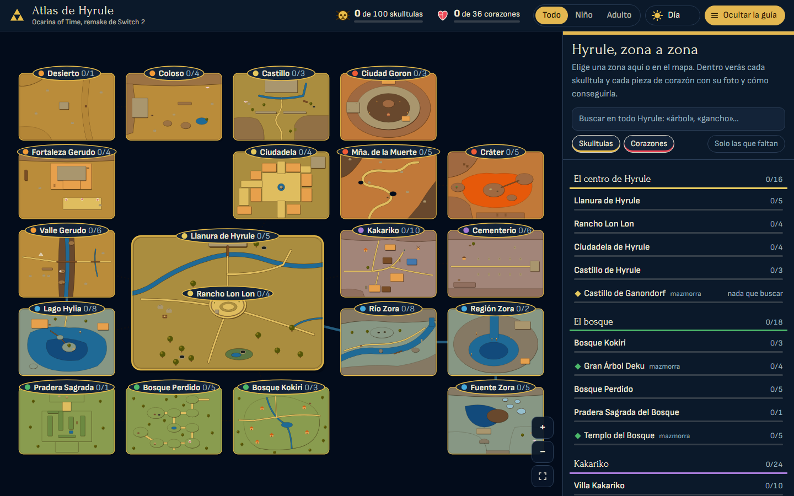
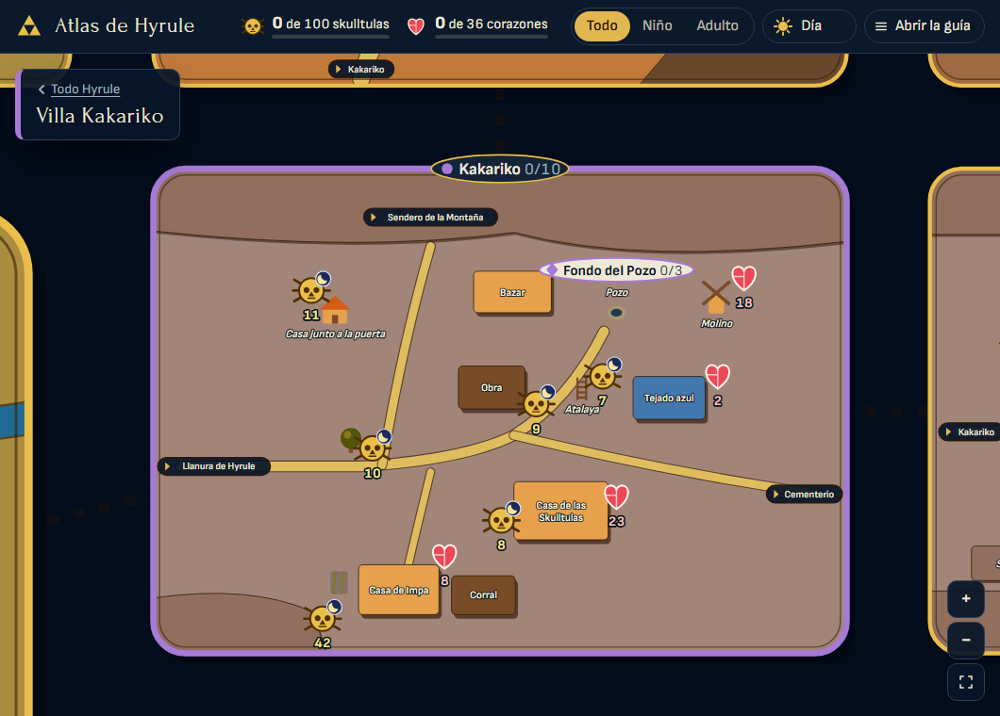
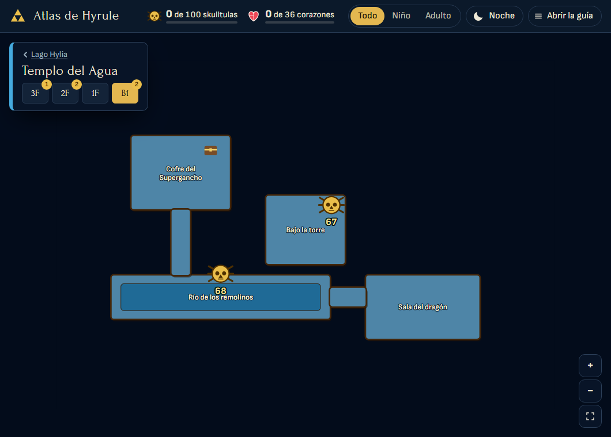

# Atlas de Hyrule

Guía interactiva del remake de *The Legend of Zelda: Ocarina of Time* (Switch 2, noviembre de 2026):
las **100 skulltulas doradas** y las **36 piezas de corazón**, zona a zona y mazmorra a mazmorra,
con el sitio exacto en el mapa, una foto y cómo conseguir cada una.

**[Abrir la guía](https://xavierpandele.github.io/atlas-de-hyrule/)** · no hay que instalar nada

## Qué hace

- **Todo Hyrule en un tablero.** Veinte zonas dibujadas y doce mazmorras por pisos. Te mueves
  arrastrando y con la rueda, o eligiendo la zona en el índice.
- **Una ficha por coleccionable.** Foto del sitio con una flecha, explicación en español, si es de
  niño o de adulto, si solo sale de noche y qué objetos hacen falta.
- **Te dice qué necesitas.** Cada ficha lleva su «Necesitas: …», y al pulsar un objeto ves todo
  lo que lo pide en Hyrule: útil cuando acabas de conseguir el gancho o el bumerán.
- **Las diez judías mágicas, marcadas.** Dónde se planta cada una, qué te da al volver de adulto
  y un aviso en las fichas que dependen de ella si aún no la has plantado.
- **Pensada para el remake.** Recoge lo que ha cambiado respecto a N64 y 3DS: la skulltula nueva
  junto al vendedor de judías, la pieza de corazón de la Caverna de Hielo que ahora vende un Deku
  en el cráter, los dos puzles nuevos de viaje en el tiempo…
- **Lleva la cuenta.** Marca lo que ya tienes y el progreso se guarda en tu navegador, por zona
  y en total.
- **Filtros que ahorran paseos.** Solo niño o solo adulto, solo skulltulas o solo corazones,
  «solo las que faltan» y un buscador («gancho», «árbol», «noche»…).
- **Día y noche.** El mapa cambia de oro a plata y las skulltulas que solo salen de noche brillan.

| Una zona | Una mazmorra, piso a piso |
|---|---|
|  |  |

## Cómo se usa

1. Elige una zona en el índice de la derecha o tocando su lámina en el mapa.
2. Cada número del mapa es una ficha de la guía. Tócalo y verás la foto y la explicación.
3. Marca **«Ya la tengo»** cuando la consigas.

Los seis colores agrupan las zonas por dominio (centro, bosque, Kakariko, montaña, zora y
desierto); cada mazmorra comparte color con la zona desde la que se entra.

## Usarla sin conexión

Es una página estática: descarga el repositorio y abre `index.html`. Sin conexión funciona todo
menos las fotos, que se cargan desde TheGamer. Si quieres tenerlas también, guarda tus propias
capturas en `capturas/` con el nombre de cada ficha (`gs1.jpg` … `gs100.jpg`, `hp1.jpg` … `hp36.jpg`).

## Lo que conviene saber

- **Los mapas son esquemas dibujados a mano**, no cartografía del juego: sirven para orientarse
  por referencias (casas, árboles, salas con nombre), no para medir distancias.
- **Los planos de las mazmorras no dibujan las puertas** entre salas.
- **Cuatro skulltulas tienen la ubicación dudosa** porque las guías consultadas se contradicen
  (17, 37, 86 y 98). Su ficha lo avisa.
- Los nombres en español son los clásicos de la saga; puede que el remake traduzca alguno distinto.

¿Has encontrado un error en una ubicación? Abre una incidencia con el número de la ficha.

## Cómo está hecho

HTML, CSS y JavaScript sin dependencias ni compilación.

| Archivo | Qué contiene |
|---|---|
| `js/data.js` | Las 136 fichas: título, descripción, edad, requisitos y notas del remake |
| `js/maps.js` | Los mapas, escritos en un mini-lenguaje de una orden por línea, y la posición de cada marcador |
| `js/capturas.js` | De dónde se carga la foto de cada ficha |
| `js/app.js` | Dibujo del mapa, zoom, guía, filtros y progreso |
| `css/style.css` | Todo el aspecto, con los colores como tokens en OKLCH |
| `docs/DIRECCION.md` | Por qué tiene este aspecto: qué se probó, qué se descartó y qué queda sin comprobar |

## Créditos

Proyecto de aficionado, sin relación con Nintendo. Los datos salen de las guías de
[RPG Site](https://www.rpgsite.net/guide/21634-the-legend-zelda-ocarina-time-remake-gold-skulltula-locations-guide),
[Respec](https://www.respec.net/guide/280-the-legend-zelda-ocarina-time-remake-pieces-heart-list-every-heart-piece-location-including-those-moved-for-switch-2)
y [TheGamer](https://www.thegamer.com/the-legend-of-zelda-ocarina-of-time-all-gold-skulltula-locations/),
contrastadas entre sí. Las fotos son de TheGamer y se enlazan desde su web; no están en este
repositorio. Detalle y licencias en [`CREDITS.md`](CREDITS.md). El código es MIT ([`LICENSE`](LICENSE)).
